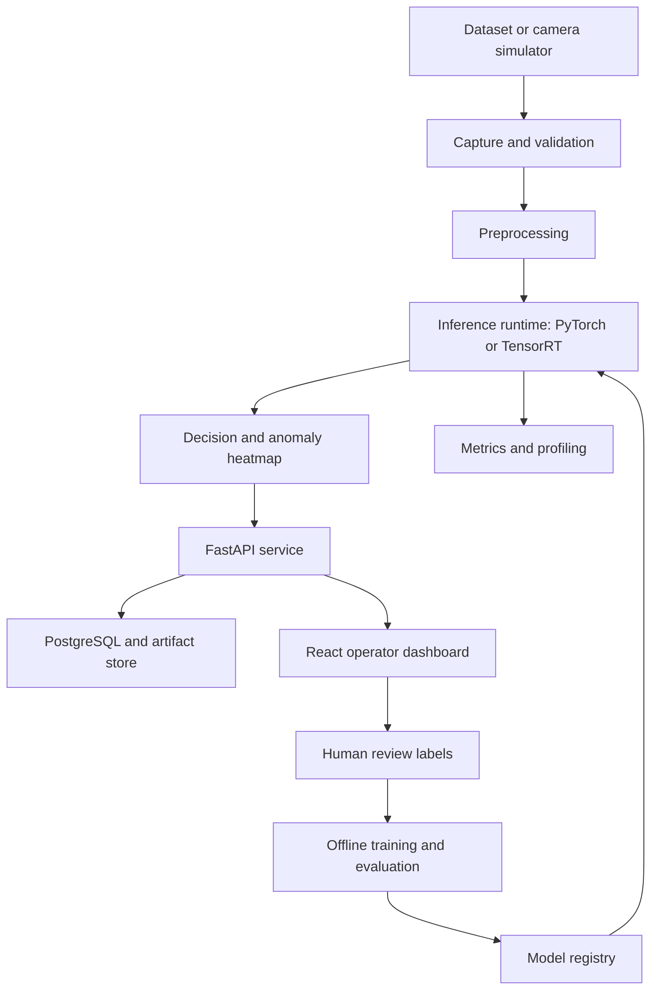

# ForgeVision AI
## Industrial Visual Inspection & GPU-Accelerated Edge AI Platform

**Project type:** Production-style computer vision and industrial AI portfolio project  
**Estimated effort:** 10–14 weeks part-time, assuming familiarity with Python and ML; advanced features may extend this timeline.  
**Target roles:** Computer Vision Engineer, ML Engineer, Python Software Engineer, C++ Engineer, Edge AI Engineer, NVIDIA Deep Learning / Developer Technology Engineer.

## 1. Executive summary

Build an end-to-end visual inspection platform that identifies manufacturing defects, localizes anomalies, records inspection decisions and enables operators to review uncertain predictions. Train and evaluate models in PyTorch, then deploy them through a GPU-accelerated C++/TensorRT pipeline. The project must demonstrate measurable engineering improvements rather than merely integrating a pretrained model.

German manufacturing companies need reliable inspection of metal, plastic, electronic and automotive components. A simulated production line using public datasets and recorded video makes this problem approachable without access to a real factory. The system is a research prototype, not a certified industrial safety or quality-control product.

## 2. Objectives and scope

- Train an anomaly detector using predominantly defect-free images and a supervised detector or segmenter where appropriate labels exist.
- Produce image-level decisions and pixel-level defect localization.
- Support repeatable image inspection and simulated live camera streams.
- Export a compatible model to ONNX and optimize it with TensorRT.
- Implement and profile a custom CUDA preprocessing operation.
- Provide a review dashboard, model versioning, audit history and operational monitoring.
- Publish reproducible accuracy, latency, throughput and resource benchmarks.

**MVP:** one product category, one anomaly model, offline inspection, REST API, review dashboard, reproducible evaluation.  
**Advanced scope:** multi-camera streams, C++ runtime, TensorRT, custom CUDA kernel, active-learning review loop.  
**Non-goals:** physical PLC control, automatic safety-critical decisions, certification, or guaranteed real-factory performance.

## 3. Users and workflows

| User | Workflow |
|---|---|
| Quality operator | Select line, inspect image, view heatmap, accept/reject or request review |
| Quality engineer | Review defect trends, inspect false positives, export corrected labels |
| ML engineer | Train model, compare experiments, register candidate, approve rollout |
| System administrator | Configure streams, monitor service health, roll back model |

Inspection lifecycle: capture → validate → preprocess → infer → score/localize → apply threshold → persist result → operator review if uncertain. A failed inference must be recorded as an error or review-required, never silently treated as a pass.

## 4. Technology stack

| Layer | Core | Advanced |
|---|---|---|
| Languages | Python 3, TypeScript | C++17/20, CUDA C++ |
| ML | PyTorch, torchvision, NumPy, scikit-learn | PatchCore, PaDiM, segmentation models |
| Vision | OpenCV | GStreamer, NVIDIA DeepStream |
| Inference | PyTorch, ONNX Runtime | TensorRT, Nsight Systems/Compute |
| Backend | FastAPI, Pydantic, SQLAlchemy | Background worker, Redis if needed |
| Storage | PostgreSQL, local artifact storage | S3-compatible object storage |
| UI | React, TypeScript | Live event updates via SSE |
| Operations | Linux, Git, Docker Compose, pytest | MLflow, Prometheus, Grafana |
| CI | GitHub Actions, Ruff, mypy | CMake, GoogleTest, GPU runner |

Pin versions after checking the CUDA, driver, TensorRT and DeepStream compatibility matrices. Keep CPU development possible; GPU integration tests require compatible NVIDIA hardware.

## 5. System architecture



Separate the training pipeline from the inference runtime. Use an explicit model manifest containing model version, input shape, normalization, threshold, artifact hash and supported precision. Keep preprocessing consistent between Python and C++.

## 6. Data and model development

Use [MVTec AD](https://www.mvtec.com/company/research/datasets/mvtec-ad) for industrial anomaly detection and consider [VisA](https://github.com/amazon-science/spot-diff) for an additional evaluation dataset. Check dataset and pretrained-weight licenses before redistribution; store download instructions rather than committing raw data.

### Experimental protocol

1. Select one category, then expand to several categories after the MVP.
2. Use official splits where supplied. Reserve validation data for threshold and hyperparameter selection; never tune on the final test set.
3. Train or fit a simple baseline (e.g. convolutional autoencoder), then compare with PatchCore or PaDiM. PatchCore uses pretrained features and a memory bank rather than conventional end-to-end training; describe that accurately.
4. For supervised segmentation, use labeled masks only from an appropriate training split or a separate dataset. Do not repurpose official test masks for training.
5. Log seeds, preprocessing, configuration, hardware, training time and artifact hashes.
6. Report image AUROC, pixel AUROC, precision/recall, F1, false-positive and false-negative rates at the chosen threshold. Include per-category results and failure examples.

## 7. GPU engineering

- Establish CPU and PyTorch GPU baselines with identical preprocessing and inputs.
- Export ONNX, check numerical parity, and build a TensorRT engine for supported hardware and input shapes.
- Compare FP32 and FP16; add INT8 only with a suitable calibration dataset and supported operators. Report accuracy changes.
- Implement a fused resize/normalization or normalization/layout-conversion CUDA kernel. Compare against an equivalent baseline; test odd dimensions and non-contiguous inputs where supported.
- Use CUDA events for device timing, synchronized wall-clock timing for end-to-end latency, warm-up iterations, and repeated measurements.
- Profile transfer overhead, kernel duration and bottlenecks using Nsight. Investigate pinned memory and asynchronous transfers only after establishing a baseline.
- For multi-camera streaming, use bounded queues and explicit backpressure/drop policy. Report dropped frames and queue latency.

## 8. API and persistence

| Endpoint | Purpose |
|---|---|
| POST /v1/inspections | Upload image and request inspection |
| GET /v1/inspections/{id} | Retrieve decision, model version, score and heatmap reference |
| GET /v1/inspections | Filter by line, category, status and time |
| POST /v1/inspections/{id}/review | Record operator correction |
| GET /v1/models | List model versions and metrics |
| POST /v1/models/{id}/activate | Authorized model activation |
| GET /healthz | Liveness |
| GET /readyz | Runtime readiness |
| GET /metrics | Operational metrics |

Database entities: `production_lines`, `products`, `model_versions`, `inspections`, `defect_regions`, `reviews`, `audit_events`. Use foreign keys, timestamps, indexed filters and migration scripts. Store large images and heatmaps outside PostgreSQL with controlled access and retention.

Validate MIME type and decoded image dimensions; enforce upload limits, authentication, role-based permissions and safe artifact paths. Use synthetic or public images for demos; do not publish confidential production data.

## 9. Dashboard requirements

- Live inspection screen: image, heatmap overlay, confidence/score, model version, processing time.
- Review queue: filter uncertain cases, correct decision, add notes, preserve audit trail.
- Analytics: defect rate by category, trend over time, false-positive review statistics.
- Model management: evaluation summary, active version, authorized rollback.
- Operations: throughput, latency, queue depth, GPU utilization and error rate.

## 10. Repository structure

```text
forgevision-ai/
  configs/                 # experiment and runtime settings
  data/README.md           # download and split instructions
  training/                # datasets, models, training, evaluation
  inference/python/        # baseline and ONNX runtime
  inference/cpp/           # CMake, TensorRT runtime
  inference/cuda/          # custom kernels and tests
  streaming/               # video simulator and DeepStream configs
  backend/                 # FastAPI, database, migrations
  frontend/                # React dashboard
  benchmarks/              # repeatable benchmark scripts
  tests/                   # unit, integration, parity tests
  infra/                   # Docker Compose and monitoring
  docs/                    # architecture, model cards, reports
  .github/workflows/
  README.md
```

## 11. Implementation roadmap

| Weeks | Deliverable | Acceptance criteria |
|---|---|---|
| 1–2 | Dataset and baseline | Reproducible splits and evaluation script |
| 3–4 | Anomaly model and localization | Held-out metrics, heatmaps, failure analysis |
| 5–6 | API and database | Inspection results persist; invalid uploads rejected |
| 7–8 | Operator dashboard | Review workflow and audit history work end-to-end |
| 9–10 | ONNX and TensorRT runtime | Numerical parity checked; GPU benchmark report |
| 11–12 | C++/CUDA optimization | Kernel correctness tests and profiling report |
| 13–14 | Streaming, monitoring, release | Demo, CI, documentation, known limitations |

If time is limited, release the MVP after week 8 and treat multi-camera support as a stretch milestone.

## 12. Testing and benchmarking

| Test area | Required evidence |
|---|---|
| ML | Split integrity, deterministic evaluation, threshold selection |
| Runtime | Python/C++ preprocessing parity, ONNX/TensorRT output tolerance |
| CUDA | CPU reference comparison, edge shapes, memory checks |
| API | Validation, permissions, persistence, error handling |
| Streaming | Backpressure, disconnect, recovery, dropped frames |
| Performance | p50/p95/p99 latency, FPS, GPU memory, utilization |

Publish a benchmark table with columns for hardware, model, precision, batch size, input size, accuracy, latency, throughput and peak memory. Leave results blank until measured. Do not compare CPU and GPU runs without documenting hardware and methodology. No fixed speedup is promised.

## 13. Hardware and deployment

Develop the API, UI, tests and baseline on a normal computer. Use a compatible NVIDIA GPU locally or rented for TensorRT and CUDA milestones. Start with one GPU and small models; Jetson deployment is optional and requires its own compatible software stack. Set a rental spending cap and shut down idle instances. Deploy locally via Docker Compose; cloud deployment is optional.

## 14. Career relevance

German target sectors: industrial automation, optics, automotive suppliers, robotics, manufacturing quality and medical imaging (non-clinical prototype only). Example employers to research: ZEISS, Siemens, Bosch, KUKA, Agile Robots and industrial vision SMEs. NVIDIA alignment: DeepStream, TensorRT, CUDA, C++ and accelerated vision. These are target sectors and skills, not verified current junior vacancies or hiring guarantees.

Portfolio deliverables: public repository, architecture diagram, model card, benchmark report, 3-minute demo, reproducible setup, CI status and a technical write-up explaining failure cases and optimization trade-offs.

## 15. Official learning resources

- [PyTorch tutorials](https://pytorch.org/tutorials/)
- [NVIDIA TensorRT documentation](https://docs.nvidia.com/deeplearning/tensorrt/)
- [NVIDIA DeepStream documentation](https://docs.nvidia.com/metropolis/deepstream/dev-guide/)
- [CUDA programming guide](https://docs.nvidia.com/cuda/cuda-c-programming-guide/)
- [NVIDIA Nsight Systems](https://developer.nvidia.com/nsight-systems)
- [MLflow documentation](https://mlflow.org/docs/latest/)

## 16. Definition of done

A reviewer can reproduce evaluation, run an inspection, review a prediction, inspect a model version and reproduce at least one GPU optimization experiment. All measured claims have scripts and hardware details. Document unsupported configurations, dataset limitations and any incomplete stretch goals.
